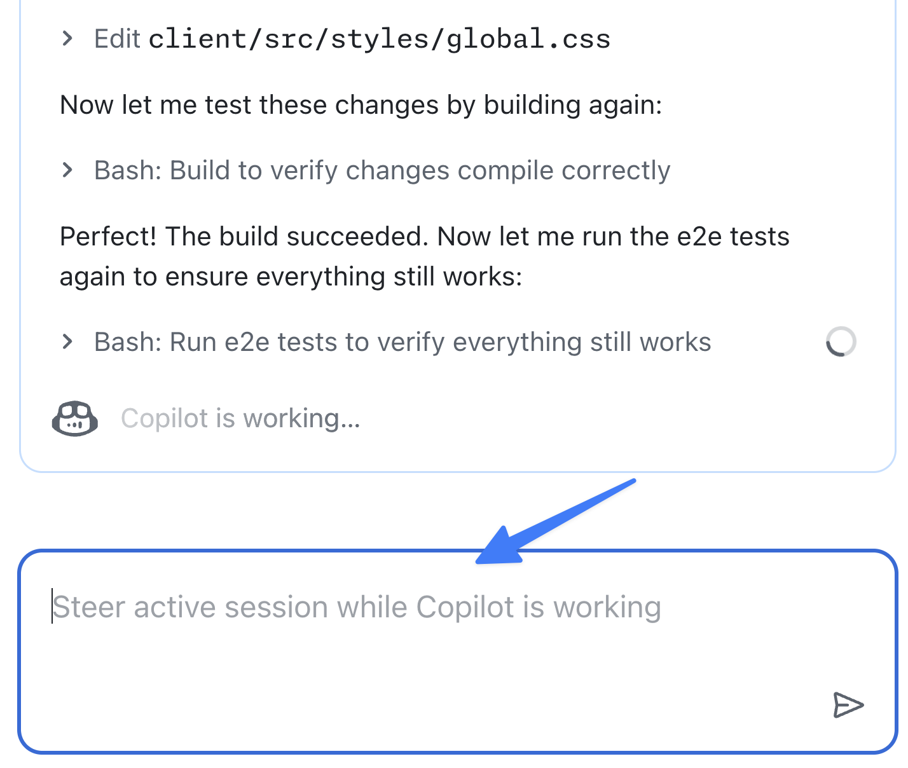

これまでの演習では、ユーザー体験の改善と機能追加のため、Copilot cloud agent に 3 つのタスクを依頼しました。cloud agent は非同期かつ自律的に作業しますが、進行状況を監視することも重要です。

GitHub.com の[エージェント ページ][agents-page]など、cloud agent に割り当てたタスクを管理する方法はいくつかあります。この Mission Control では、オープンなプルリクエスト (PR) があるエージェント タスクを確認し、実行内容を調べ、進行中のセッションに追加の指示を送れます。

このレッスンでは、エージェント ページでタスクを監視し、進行中のセッションに追加機能を依頼します。

## シナリオ

高コントラスト モードの作成を依頼した後、チームはライト モードも追加したいと考えました。サイトのスタイルと切り替え機能をすでに変更中なので、同じ作業に含めることができます。セッションに指示を追加し、高コントラストに加えてライト モードも実装させます。

## cloud agent のタスクを確認する

Copilot cloud agent に割り当てたタスクの状態を確認します。

1. [Copilot エージェント ページ](https://github.com/copilot/agents)を開きます。
2. メイン ペインと左ペインのタスク一覧を確認します。たとえば、コード ドキュメントの更新、ゲームを変更する API の生成、Web サイトへの高コントラスト モード追加などのタスクが表示されます。
3. 実行中のタスクを選択し、Copilot が行った操作を確認します。リポジトリのチェックアウト、環境の作成、Model Context Protocol (MCP) サーバーの設定、タスクを完了するための作業などが表示されます。

> [!NOTE]
> 表示される手順は、作業の状態や Copilot が選んだ方法によって異なります。

4. 右側に表示される PR ペインで、PR と変更ファイルも確認します。

## cloud agent に追加の指示を送る

高コントラスト モードのセッションに、ライト モードの切り替えも追加するよう依頼します。

1. 高コントラスト モードを実装しているセッションを選択します。タイトルはエージェントの命名や作業状態によって異なります。

   

2. セットアップが終わり、作業が始まったことを示すメッセージが表示されるまで数分待ちます。
3. **Steer active session while Copilot is working** ダイアログに次のプロンプトを入力します。

   ```plaintext
   While we are working on a high contrast mode, let's also add a light mode. There should be a switch for this mode as well where users can select their desired display mode.
   ```

   

4. <kbd>Enter</kbd> を押してプロンプトを送信します。
5. Copilot がプロンプトを認識し、作業に取り込んだことを確認します。

## Copilot の作業を待つ

Copilot は、メッセージを送信した時点で実行中の手順を終えた後、追加の依頼を作業に取り込みます。完了まで数分かかることがあります。その間に、これまでに学んだことを振り返ってください。

## まとめと次のステップ

Copilot cloud agent のタスクを監視し、誘導するためのエージェント ページを確認しました。実行中と完了済みのタスク、作業内容を確認し、進行中のタスクに追加指示を送る方法を学びました。

このレッスンでは、次のことを行いました。

- エージェント ページを使って cloud agent のタスクを監視しました。
- 進行中のセッションに追加機能を依頼しました。

次は Copilot が作成した PR を[反復して改善します][next-lesson]。

## リソース

- [Copilot エージェント ページ][agents-page]
- [カスタム エージェントについて][custom-agents]

---

| [← 前のレッスン: カスタム エージェント][previous-lesson] | [次のレッスン: Copilot の作業を反復する →][next-lesson] |
|:--|--:|

[previous-lesson]: ../3-custom-agents/
[next-lesson]: ../5-iterating/
[agents-page]: https://github.blog/changelog/2025-07-03-agents-page-for-copilot-coding-agent-in-public-preview
[custom-agents]: https://docs.github.com/copilot/concepts/agents/cloud-agent/about-custom-agents
