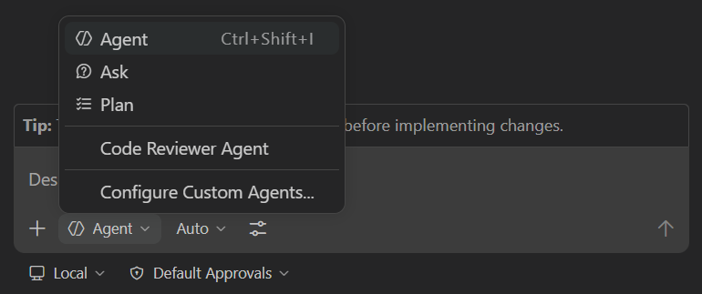

[← 前のレッスン: 前提条件][previous-lesson] · [次のレッスン: Agent mode →][next-lesson]

生成 AI を使うときはコンテキストが重要です。作業方法や背景情報を Copilot が参照できるようにするには、[指示ファイル][instruction-files]が役立ちます。

この演習では、次のことを行います。

- リポジトリのカスタム指示とパスで適用範囲を限定した指示ファイルを通じて、プロジェクト固有のコンテキスト、コーディング ガイドライン、ドキュメント標準が Copilot にどう伝わるかを確認します。
- 現在の指示を使って、フィルタリング用の最初のデータ スライス (発行元ヘルパー) を生成します。
- `.github/copilot-instructions.md` にリポジトリ全体に適用する標準を追加します。
- 同じプロンプトを再実行し、生成コードが新しい標準に従うことを確認します。
- 指示の変更とフィルタリングの基礎を `main` にコミットし、次の演習で Copilot が新しい指針を使えるようにします。

> [!CAUTION]
> 生成コードが設定した標準から外れる場合があります。Copilot の動作は確率的です。この演習では、出力の文字単位の一致ではなく、指示の変更後に傾向が変わることを確認します。

## 指示ファイル

### シナリオ

Tailspin Toys には開発ガイドラインがあります。データ層には単体テストを用意すること、UI はダーク モードで現代的にすること、コードに TSDoc コメントを追加すること、各ファイルの先頭に役割を説明するコメントを追加することが求められます。指示ファイルを使い、Copilot がこの慣行に沿って作業できるようにします。

### カスタム指示

カスタム指示は、コーディング スタイルや要件などのコンテキストを Copilot に伝えます。リポジトリ全体や特定の種類のファイルに適用できます。

- `.github/copilot-instructions.md` は、リポジトリに対する**すべての** Copilot リクエストで使われる単一の指示ファイルです。技術スタック、プロジェクトの概要、ベスト プラクティスなど、広く適用される情報を記載します。
- `.github/instructions/*.instructions.md` は、特定のタスクやファイルの種類に指針を与えるファイルです。TypeScript や Astro などの言語、UI コンポーネントの作成、単体テストの追加などに利用できます。

> [!NOTE]
> IDE では、指示ファイルは Copilot Chat のコード生成にのみ使われ、コード補完や次の編集候補には使われません。
>
> Copilot Chat、Copilot CLI、Copilot cloud agent は、リポジトリ レベルの指示と、`applyTo` フロントマターで適用範囲を指定した `*.instructions.md` ファイルを使います。
>
> Copilot は AGENTS.md や CLAUDE.md など、ほかの形式の指示ファイルにも対応しています。詳細は[カスタム指示のサポート][custom-instructions-support]を参照してください。

指示ファイルの作成方法に唯一の正解はありません。プロジェクトの例を参考に、自然な言葉で明確に書き、良い例と避けるべき例を示します。必要に応じて試しながら調整してください。

> [!TIP]
> このプロジェクトには [UI の指示][ui-instructions]や [Astro の指示][astro-instructions]など、さまざまな指示ファイルがあります。VS Code の **Configure Chat → Generate Agent Instructions** や Copilot CLI の `/init` を使い、Copilot に作成を手伝わせることもできます。テンプレートは [awesome-copilot][awesome-copilot]で探せます。

[ui-instructions]: https://github.com/github-samples/tailspin-toys/blob/main/.github/instructions/ui.instructions.md
[astro-instructions]: https://github.com/github-samples/tailspin-toys/blob/main/.github/instructions/astro.instructions.md
[awesome-copilot]: https://github.com/github/awesome-copilot
[custom-instructions-support]: https://docs.github.com/copilot/reference/custom-instructions-support

## このプロジェクトのカスタム指示ファイルを確認する

変更前に、スターター プロジェクトに含まれる指示ファイルを確認します。

1. Codespace に戻ります。
2. `.github/copilot-instructions.md` を開きます。
3. プロジェクトの説明、**Agent notes**、**Code standards**、**Scripts**、**Repository Structure** などを確認します。**Code standards** 内の **GitHub Actions Workflows** の指針も Copilot とのすべてのやりとりに適用されます。
4. `.github/instructions` フォルダーを開き、Astro、Drizzle データ層、テストなどの指示を確認します。
5. `.github/instructions/unit-tests.instructions.md` を開き、先頭の `applyTo` フィールドがリポジトリのルートからの glob で適用先を指定することを確認します。たとえば `**/*.test.ts` に一致する TypeScript テスト ファイルに適用されます。
6. 単体テストに関する指示を確認します。
7. `.github/instructions/drizzle.instructions.md` の末尾で、指示ファイルやプロジェクト ファイルへのリンクを確認します。パスは指示ファイルからの相対パスです。

> [!NOTE]
> `.github/copilot-instructions.md` の **Code formatting requirements** にはコーディング標準が記載されていますが、コード内のドキュメントはまだ必須ではありません。次の手順で TSDoc コメントとファイル先頭コメントを追加します。

## 変更用ブランチを作成する

変更をブランチで管理します。

1. 前の演習で使った Codespace に戻ります。
2. <kbd>Control</kbd>+<kbd>\`</kbd> (Mac) または <kbd>Ctrl</kbd>+<kbd>\`</kbd> (Windows/Linux) を押して新しいターミナルを開きます。
3. ブランチを作成して切り替えます。

   ```bash
   git checkout -b custom-instructions
   ```

## 指示を更新する前に Copilot Chat を使う

変更前の指示でコード生成プロンプトを送信し、後で指示を更新して同じプロンプトを再送信し、違いを確認します。

> [!TIP]
> **Copilot Chat を開く**
>
> Codespace に戻り、Copilot Chat パネルを開き、**New Chat** を選択して新しい会話を始めます。モードとモデルの選択は演習によって異なります。必要な場合は各手順で説明します。

1. 前の演習で開いたエディター タブを閉じ、Copilot が必要なコンテキストだけを使うようにします。
2. `src/lib/publishers.ts` を開き、ヘルパーを配置する場所を Copilot に示します。
3. Chat ビューのエージェント ドロップダウンから **Agent** を選択します。

   

4. 次のプロンプトを送信します。

   ```plaintext
   Create or update src/lib/publishers.ts with a data-access helper that returns a list of all publishers with the name and id for each. Apply the file changes.
   ```

5. Copilot がプロジェクトを調べてコードを適用する様子を確認します。ヘルパーとテストなど、複数のファイルが変更される場合があります。
6. データ層の規約により、提案されたヘルパーが最初の引数として `db` クライアントを受け取り、型付きの発行元配列を返すことを確認します。この規約は `src/lib/*.ts` に適用される `.github/instructions/drizzle.instructions.md` に記載されています。
7. 提案されたコードには、TSDoc コメントとファイル先頭のコメントがないことを確認します。

> [!CAUTION]
> Copilot は確率的に動作するため、指示がなくてもドキュメント コメントを追加する場合があります。その場合も問題ありません。この演習では、指示を更新した後の一貫性の向上を確認します。

## リポジトリ全体に適用する標準を追加する

`.github/copilot-instructions.md` にコード内のドキュメント標準を追加します。

1. `.github/copilot-instructions.md` を開き直します。
2. **Code formatting requirements** セクション (27 行目付近) を探し、コード内ドキュメントの規則がまだないことを確認します。
3. 既存の標準の直後に、次の項目を追加します。

   ```markdown
   - Every exported function should have a TSDoc comment describing its purpose, parameters, and return value.
   - Before imports or any code, add a comment block to the file that explains its purpose.
   ```

4. `copilot-instructions.md` を保存します。

> [!TIP]
> リポジトリ全体の標準は `.github/copilot-instructions.md` に、特定の言語、ファイル、タスクの指示は `*.instructions.md` に置きます。今回の TSDoc 規則はプロジェクト全体に適用するため、リポジトリ レベルのファイルが適しています。

## 同じプロンプトを再送信して違いを確認する

更新後の指示がコードに与える影響を確認します。

1. Copilot Chat に戻り、**New Chat** を選択して会話を新しくします。
2. `src/lib/publishers.ts` を選択し、Copilot の対象ファイルにします。
3. 前と**同じプロンプト**を送信します。

   ```plaintext
   Create or update src/lib/publishers.ts with a data-access helper that returns a list of all publishers with the name and id for each. Apply the file changes.
   ```

4. 提案されたファイルの先頭に、次のようなコメント ブロックがあることを確認します。

   ```typescript
   /**
    * Publisher data-access helpers for the Tailspin Toys Crowd Funding platform.
    * Provides functions to retrieve publisher information from the database.
    */
   ```

5. 関数に次のような TSDoc コメントがあることを確認します。

   ```typescript
   /**
    * Returns a list of all publishers with their id and name.
    *
    * @param db - The Drizzle database client.
    * @returns A promise that resolves to an array of publisher objects.
    */
   ```

新しいプロジェクト標準を Copilot に適用し、次の演習でも使う実際のコードに反映しました。

## 指示とブランチをコミットしてプッシュする

指示ファイルもほかのファイルと同じようにバージョン管理します。ヘルパーの基礎も含めてコミットします。

1. <kbd>Control</kbd>+<kbd>\`</kbd> (Mac) または <kbd>Ctrl</kbd>+<kbd>\`</kbd> (Windows/Linux) を押して、新しいターミナルを開きます。
2. 変更を確認します。

   ```bash
   git status
   ```

3. 指示ファイルと、Copilot がヘルパーの基礎に加えたすべてのファイルをステージしてコミットします。

   ```bash
   git add .github/copilot-instructions.md src/lib/publishers.ts
   # If git status shows additional supporting updates (for example tests), add those files too.
   git commit -m "Add doc comment standards and publishers helper foundation"
   ```

4. ブランチをリポジトリにプッシュします。

   ```bash
   git push -u origin custom-instructions
   ```

## プルリクエストを作成してマージする

プッシュしたブランチから PR を作成し、ドキュメント標準の Issue に関連付けます。GitHub ツールがプロジェクトに接続されているので、Copilot に依頼できます。

> [!NOTE]
> この演習では初めて Copilot に GitHub 上の操作を依頼します。テンプレートには GitHub ツールが設定済みです。Copilot が初めてツールを使うとき、VS Code から GitHub サインインを求められる場合があります。指示に従って認証してください。接続の仕組み (Model Context Protocol) は後の演習で扱います。

1. Codespace で Copilot Chat を開きます。
2. <kbd>Control</kbd>+<kbd>Command</kbd>+<kbd>I</kbd> (Mac) または <kbd>Ctrl</kbd>+<kbd>Alt</kbd>+<kbd>I</kbd> (Windows/Linux) を押して Copilot Chat ビューを開き、エージェント ピッカーで **Agent** が選択されていることを確認します。
3. 次のプロンプトで、指示更新と発行元ヘルパーの基礎を説明する PR を作成するよう依頼します。

   ```plaintext
   Find the issue related to updating the instructions file. Create a new PR from the current branch, highlight that the PR closes that issue, and include that we also added the publishers helper foundation for the upcoming filtering work.
   ```

4. Copilot が Issue の検索や操作を行う際に **Allow** を求めたら、実行内容を確認して許可します。
5. PR が作成されたら、次のプロンプトでマージしてローカルのブランチを `main` に戻すよう依頼します。

   ```plaintext
   Merge the PR into main. Then return to main locally, and pull the latest code so we are up to date.
   ```

6. GitHub 操作やシェル コマンドの実行に対して **Allow** を求められたら、内容を確認して許可します。

GitHub Copilot の支援で PR を作成し、マージしました。

## まとめと次のステップ

この演習では、指示ファイルから Copilot がコンテキストを得る方法を確認し、VS Code の Copilot Chat で次の作業を行いました。

- リポジトリのカスタム指示とパスで適用範囲を限定した指示ファイルを通じて、プロジェクト固有のコンテキスト、コーディング ガイドライン、ドキュメント標準が Copilot にどう伝わるかを確認しました。
- 既存の指示でコード生成プロンプトを送り、提案を確認しました。
- `.github/copilot-instructions.md` にリポジトリ全体の標準を追加しました。
- 同じプロンプトを再送信し、提案されたコードが新しい標準に従うことを確認しました。
- 指示の変更と発行元ヘルパーの基礎をコミットして `main` に反映し、次の演習で利用できるようにしました。

次は[agent mode][next-lesson]を使い、コードベース全体に新機能を追加します。

## リソース

- [GitHub Copilot のカスタマイズに使う指示ファイル][instruction-files]
- [カスタム指示を作成するためのベスト プラクティス][instructions-best-practices]
- [Copilot 向けの優れたカスタム指示を書くための 5 つのヒント][copilot-instructions-five-tips]
- [GitHub Copilot の個人用カスタム指示][personal-instructions]
- [Awesome Copilot — 指示ファイルなどのコレクション][awesome-copilot]

[previous-lesson]: ../0-prerequisites/
[next-lesson]: ../2-agent-mode/
[instruction-files]: https://code.visualstudio.com/docs/copilot/copilot-customization
[instructions-best-practices]: https://docs.github.com/enterprise-cloud@latest/copilot/using-github-copilot/coding-agent/best-practices-for-using-copilot-to-work-on-tasks#adding-custom-instructions-to-your-repository
[personal-instructions]: https://docs.github.com/copilot/customizing-copilot/adding-personal-custom-instructions-for-github-copilot
[copilot-instructions-five-tips]: https://github.blog/ai-and-ml/github-copilot/5-tips-for-writing-better-custom-instructions-for-copilot/
[awesome-copilot]: https://github.com/github/awesome-copilot
